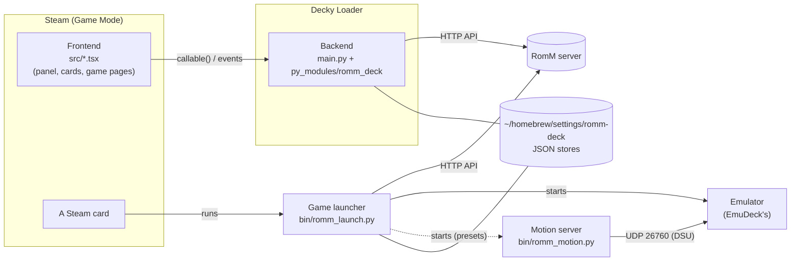
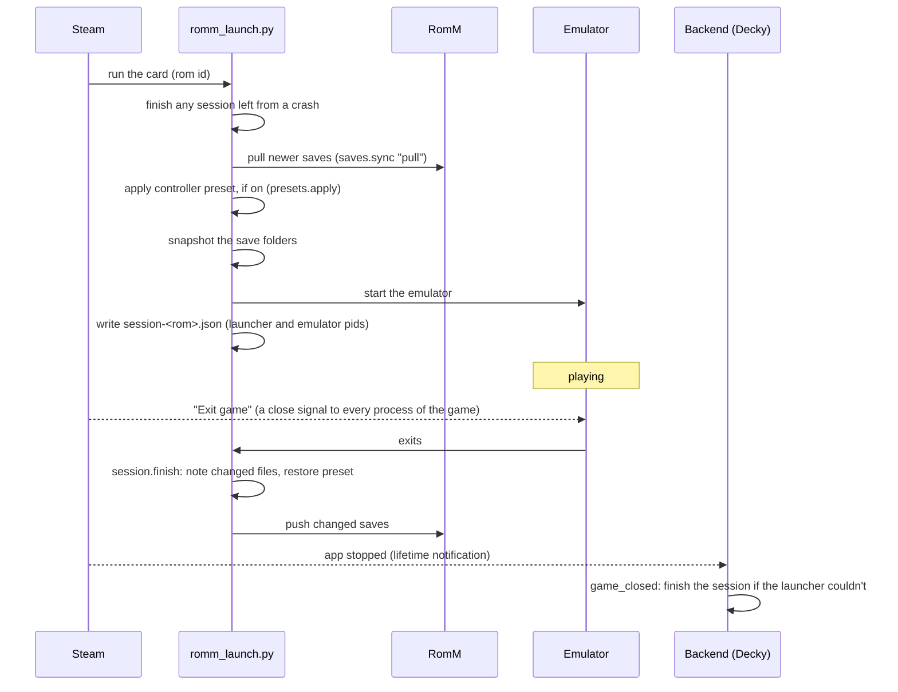

# Architecture

This page is the map for a developer new to the repository: how it's laid out, how the plugin is put together,
and how data moves through it. RomM Deck connects three things that don't normally talk to each other: a RomM
server, an EmuDeck install, and Steam's Game Mode. [CONTRIBUTING.md](CONTRIBUTING.md) has the rules every
change keeps, and the pages under [`docs/`](docs) describe what the plugin does for the people using it.

## The three running parts

The plugin runs as three separate programs, started by different things:

1. **The frontend** (`src/`, bundled to `dist/index.js`) runs inside Steam's own UI. It draws the Quick
   Access panel, makes and changes Steam cards, and adds RomM's data to Steam's game pages. It can't
   touch files or the network itself, so it asks the backend for everything.
2. **The backend** (`main.py` and `py_modules/romm_deck/`) runs in Decky Loader's Python. Every public
   method of `Plugin` in `main.py` is callable from the frontend; the backend answers with JSON-able values
   and sends events back with `decky.emit()`.
3. **The game launcher** (`bin/romm_launch.py`) is what each RomM Deck card runs. Steam starts it with the
   system Python, outside Decky, so it shares the backend's modules but not its process or memory. It
   syncs saves, starts the emulator, and syncs again afterwards.

The backend and launcher share state only through files in `~/homebrew/settings/romm-deck/` (see
[State on disk](#state-on-disk)). Every write goes through `config.save` / `config.write_atomic`, which
write a temporary file and rename it, so a crash never leaves half a file. Stores that both can change
at once are edited under a file lock (`config.editing`, `saves._locked`).

## Repository layout

| Path | What it is |
|---|---|
| `main.py` | The backend's entry point: the `Plugin` class Decky loads. Thin: it validates, runs the real work in a thread (`asyncio.to_thread`) and turns failures into `{"error": ...}` |
| `py_modules/romm_deck/config.py` | Where everything lives (paths worked out from the plugin's own location), the JSON stores, atomic writes, popups from the launcher |
| `py_modules/romm_deck/api.py` | A small RomM API client (standard library only). `RomMError` is the one exception type for "RomM is unreachable or said no" |
| `py_modules/romm_deck/systems.py` | The platform table: RomM platform → EmuDeck folder, emulator, launch command, file types, Steam collection |
| `py_modules/romm_deck/library.py` | Games on this PC: download, recognising games already in `Emulation/roms`, Steam card commands, launching, removing, BIOS |
| `py_modules/romm_deck/saves.py` | Save and save-state sync with RomM, and the checks before anything is deleted |
| `py_modules/romm_deck/session.py` | What happens after a game closes, however it closes |
| `py_modules/romm_deck/presets.py` | Controller presets: emulator settings changed for the length of a game (in files, put back after, or on the emulator's command line) |
| `py_modules/romm_deck/motion.py` | The handheld's motion sensor, calibration, and the DSU motion server emulators read |
| `py_modules/romm_deck/autoload.py` | Turning off "load the last save state on start" in every emulator |
| `py_modules/romm_deck/metadata.py` | RomM's data shaped for display: covers, Steam page details, links, Activity, screenshots |
| `py_modules/romm_deck/ini.py` | Editing one key in an INI file without changing anything else in it |
| `py_modules/romm_deck/procs.py` | Recognising a process we started, safely, by pid and start time |
| `bin/romm_launch.py` | The game launcher (see above) |
| `bin/romm_motion.py` | The motion server process a preset starts for one game |
| `src/index.tsx` | The Quick Access panel and the plugin's frontend entry point |
| `src/cards.ts` | Making Steam cards, and taking over existing ones (EmuDeck's) |
| `src/current.ts` | Which game the user is on, so the panel can open on it |
| `src/steampage.tsx` | RomM's details, screenshots, links and Activity on Steam's game pages |
| `src/ui.tsx` | Small visual pieces: icons, covers, status lines |
| `src/decky.ts` | The bridge to Decky Loader's and Steam's globals |
| `tests/` | The test suites and a fake RomM server (see [Tests](#tests)) |
| `assets/brand/` | The plugin's icon: `icon.svg` is the source, `icon.png` (256 px) and `icon@2x.png` (512 px) are exported from it |
| `docs/` | The user documentation: the README is the front page, every other page sits in here |
| `.github/ISSUE_TEMPLATE/` | The bug-report form |
| `.gitea/workflows/test.yml` | Runs every test on each push to Gitea (backend on Python 3.10, frontend and zip on Node 22), with no actions downloaded from GitHub |
| `.gitea/workflows/release.yml` | Publishes a release on Gitea (Run workflow button, or a pushed version tag); its tag then reaches GitHub through the push mirror |
| `.github/workflows/release.yml` | Publishes the same release on GitHub when a version tag arrives there (or from its own Run workflow button) |
| `scripts/release_notes.py` | Shared by both release workflows: checks the version, gives the release's title, writes the notes (with the zip's install-from-URL address on GitHub) from CHANGELOG.md |
| `.gitea/workflows/store.yml` | Every six hours: refreshes the Decky store on the `store` branch with the official listing and current links |
| `scripts/update_decky_store.sh` | Fetches the `store` branch, updates it (a release, or a refresh) and pushes it back, retrying if it moved meanwhile |
| `scripts/decky_store.py` | Builds the Decky store files: RomM Deck's releases (`own.json`, links worked out from `GITEA_PUBLIC_URL`) merged with the official store's listing, into `plugins.json` and `plugins/versions.json` |
| `scripts/publish_gitea_release.py` | Creates or updates the Gitea release and uploads the zip, through Gitea's API (standard library only) |
| `scripts/check_package.py` | Checks `romm-deck.zip` the way Decky's installer reads it (one folder, `plugin.json` inside it, the files Decky loads), run by every `package.sh` |
| `package.json`, `build.mjs`, `package.sh` | The build: esbuild bundles `src/` into `dist/index.js`; `package.sh` zips the plugin for Decky and checks the zip |

## How data flows

### Pairing and browsing

1. The user enters RomM's address and a pairing code from RomM's web UI. `Plugin.connect` swaps the code
   for a client token (`/api/client-tokens/exchange`), checks it works, and saves both in `settings.json`.
2. Browsing calls `collections`, `platforms` and `roms`. Each list of games is checked against
   `Emulation/roms` on the way out (`library.find_existing`), so games that were already on the PC (copied
   by hand, or by another tool) show as "on this PC" and join `installed.json`.
3. Recognising a game that's already there is strict (`library.local_copy`, `_loose_match`): the same file
   name, the same name with another file type the emulator opens, a Switch title id in the name, or the same
   simplified name, and only when exactly one file fits. A wrong match would mix up two games' saves, so
   when in doubt it doesn't match.

### Download and Steam card

1. `Plugin.download` starts `library.install` in the background and returns at once. Progress goes to the
   panel as `progress` events, the result as one `downloaded` event.
2. `install` downloads into `Emulation/roms/<folder>` under a temporary name, unpacks zips the emulator
   can't read itself, and records the game in `installed.json`. Switch updates and DLC go to their own
   folder (the one Ryujinx loads them from), not `roms/switch`.
3. The frontend listens for `downloaded` for as long as the plugin is loaded (not just while the panel is
   open) and makes the Steam card (`cards.addCard`): the command comes from the backend
   (`library.shortcut`: `python3 romm_launch.py <rom id>`), then the cover art and Steam collection.
4. Existing cards (EmuDeck's, made by Steam ROM Manager) can be *taken over* instead (`cards.takeOver`).
   Their original command is saved in `installed.json`, and the launcher runs exactly that command, so
   names, artwork and playtime stay. Steam ROM Manager puts its own command back when it runs, so the
   frontend checks the taken-over cards again 15 seconds after it loads (`cards.repairCards`).

### Playing a game

- **Closing a game.** Steam's "Exit game" signals every process of the game, launcher included. The
  launcher ignores SIGTERM and SIGHUP so it can finish, but it can't rely on that (Steam may kill it
  outright). So the after-game work is written down as `session-<rom id>.json` as the game starts,
  and whoever sees the game has ended does it, exactly once (`session._claim` renames the file, so two
  finishers can't both take it): the launcher; the backend, when Steam reports the game stopped; or the
  backend when it starts, after a crash or power-off. A session only finishes once nothing is still
  running the game file, so the emulator has finished writing its save.
- **Processes are remembered by pid and start time** (`procs.py`). After a reboot the same pid can belong
  to something else; checking the start time too means the plugin never waits on, or stops, a stranger.
- **Popups.** The launcher can't reach the panel, so it drops a small JSON file in
  `settings/notify/`. The backend passes these on as `notify` events every half second, and the frontend
  shows them as Game Mode toasts. Notes older than two minutes (written while the plugin wasn't running)
  are dropped.

### Save sync

`saves.py` keeps a record per game in `sync.json`: which files are its saves, their hashes at the last
sync, and the version of each file last seen on RomM.

- **Finding a game's saves.** EmuDeck doesn't always manage to point an emulator at `Emulation/saves`, so
  up to three places are watched (`saves.roots`): `Emulation/saves/<emulator>`, the emulator's own folders
  (`DEFAULT_ROOTS`), and for emulators that save next to the game, the game's own folder. Folders are
  snapshotted before and after a game; files that changed while it ran become that game's
  (`remember_session`). Files named after the game, and Switch save folders found in Ryujinx's save
  index, are claimed too, for games started from other cards.
- **File keys.** A file is identified as `<folder label>/<path inside it>`, never a full path. That's what
  `sync.json` and the zips store, so a save made on one machine lands in the right place on another whose
  folders are elsewhere.
- **Upload format.** Emulators that keep one flat folder (RetroArch, melonDS) upload each file as-is,
  which RomM's own web player can use. Everything else uploads one zip per game
  (`<emulator>-<kind>.romm.zip`) that remembers where each file came from.
- **Pull, then push.** A sync downloads what's new on RomM, then uploads what changed here. If a file
  changed in both places, the newer copy wins locally and the other is uploaded as
  `conflict-<time>-<name>`. With Push or Pull (`force`), the losing side's copy is uploaded as
  `backup-<time>-<name>` first. No version of a save is ever thrown away.
- After uploading, the sync checks that RomM lists the saves under this game, and fails loudly if not.

### Removing a game

`library.uninstall` is the only path that deletes a player's data, and it is deliberately cautious:

1. sync the game's saves and states with RomM;
2. download RomM's copies and compare hashes with every save file on the PC (`saves.not_on_romm`). If any
   file isn't on RomM identically, stop: nothing is deleted;
3. delete the save files (never memory cards shared by several games, never a file another game claims),
   then the game, then its Steam card.

`_not_this_game` is a last line of defence on every deletion: it refuses anything outside `Emulation/roms`,
a whole platform folder, or a path that holds another game, whatever led there. Every deleted file is
listed in `~/homebrew/logs/romm-deck/removed.log`.

### Controller presets and motion

A preset changes a few emulator settings for the length of a game (`presets.apply` before, `restore` after).

- Each setting it will touch is recorded first, in `controller-backup.json`, as a plain JSON "change
  record" (`presets._change`): which file, which key, the value before, and the preset's value. Because
  it's on disk before anything changes, a crash midway is undone at the next launch. After the game, a
  setting is only put back if it still holds the preset's value, so a change the player made in the
  emulator meanwhile is kept.
- INI files are edited one line at a time (`ini.py`), never rewritten, so a file goes back byte for byte.
- A preset can instead give the emulator **command-line arguments** (`args()` in the preset,
  `presets.launch_args`), which `library.launch_command` puts right after the EmuDeck launcher, before the
  game's own arguments (EmuDeck's launchers pass every argument on). Nothing is recorded or put back: they
  last as long as the emulator runs. The Wii preset works this way, with Dolphin's `-C
  Wiimote.WiimoteN.Source=2`, because EmuDeck's launcher rewrites `[WiimoteN] Source` in WiimoteNew.ini (its
  controller AutoMap) just before starting Dolphin. A taken-over card only gets them when it runs that same
  EmuDeck launcher.
- A preset can also **check** that it took effect (`check(emulator_pid)` in the preset,
  `presets.check_running`). The launcher runs it in a background thread while the game runs, so it never holds
  the game up. The Wii check finds Dolphin among the game's processes (`procs.descendants`), reads Dolphin's own
  command line for the `-C` settings, and lists which programs have the Wii Remote sensor's device files open
  (`procs.holding_open`). It reports in a popup, on the game page and in the launch log, and changes nothing.
- **Motion** presets need the handheld's motion to reach the emulator. Emulators read motion over the
  DSU protocol (UDP port 26760). EmuDeck's own motion server only recognises a real Steam Deck, so the
  plugin has its own (`motion.serve`). It reads the sensor straight from the kernel (IIO), or, when
  InputPlumber is streaming from the sensor, from InputPlumber's virtual Steam Deck controller. Axes vary
  by model, so the user calibrates once (lay it flat, then stand it up) and the result is stored in
  `motion-calibration.json`. The server runs as its own process (`bin/romm_motion.py`) and stops by itself
  when the launcher is gone.

### Steam game pages

`src/steampage.tsx` makes Steam show RomM's data on the pages of RomM Deck's cards. Steam only draws a
game's info section for games it believes are Steam games, so a few of Steam's internal functions are
patched (wrapped, never replaced outright):

- `BIsModOrShortcut` answers "not a shortcut" only for a RomM Deck card, and only while that card's own
  page is open. `GetGameID`, `GetPrimaryAppID` and the icon lookup always get the real answer, so Play
  keeps working.
- `GetDescriptions`, `GetAssociations`, `GetCanonicalReleaseDate`, `BHasStoreCategory` and the rating
  return RomM's data. Data is only handed over once Steam has set the page up (earlier makes Steam crash),
  and the very same objects are reused while the data is unchanged (new but equal objects make Steam
  redraw the page, sometimes without end).
- `GetSections` adds the Screenshots and Activity sections. The section renderer is wrapped to replace
  the Game Info links row (Store page, Community...) with RomM's links, and to add RomM's Activity list.
  Tree walking only follows `props.children`: walking into Steam's stores would subscribe the render to
  them and make it re-render endlessly.
- Every patch falls back to Steam's own answer on any error, and `stop()` undoes every one when the
  plugin unloads. The panel's switch turns all of it off at once.

The data comes from the backend: `Plugin.steam_details` returns what's kept in `steam-details.json` at
once and fetches anything missing or older than a week in the background (`metadata.details`, `links`,
`activity`, `screenshots`), sending it as a `steam_details` event. Opening a page refreshes that game if its
data is over 15 minutes old, and so does closing the game. Screenshots are copied to
`~/homebrew/data/romm-deck/shots/`, which Decky serves at `http://localhost:1337/plugins/RomM Deck/data/`:
Steam's pages can't load pictures from a plain-http or self-signed RomM, but they can load from Decky.

## State on disk

All in `~/homebrew/settings/romm-deck/` unless noted.

| File | Holds | Written by |
|---|---|---|
| `settings.json` | RomM address and token, preset switches, options | backend |
| `installed.json` | Every game on this PC: path, launch file, Steam card, original card command | backend, launcher |
| `moved.json` | Old RomM id → new id, for games whose RomM entry was replaced | backend |
| `sync.json` | Per game: its save files, their hashes at the last sync, RomM versions seen | backend, launcher (locked) |
| `sync-status.json` | How each game's last sync went | backend, launcher |
| `session-<rom>.json` | A game being played (see Playing a game) | launcher; removed when finished |
| `controller-backup.json` | Change records of the preset applied right now | launcher |
| `controller-status.json` | How the last game with a preset went | launcher |
| `motion-calibration.json` | The motion sensor's axes | backend |
| `steam-details.json` | RomM's data for Steam pages, with when it was fetched | backend |
| `notify/*.json` | Popups waiting to be shown | launcher |
| `covers/` | Small cover art for the panel | backend |
| `~/homebrew/data/romm-deck/shots/` | Screenshot copies for Steam pages | backend |
| `~/homebrew/logs/romm-deck/` | `launch.log`, `motion.log`, `removed.log` | launcher, backend |

These files are bookkeeping: the saves themselves live in the emulators' folders and on RomM.

## Design choices

- **Standard library only in Python.** Decky runs the backend on its own bundled Python, where packages
  can't be installed, and the launcher runs on the system Python. Hence the hand-written multipart upload,
  the regular expressions instead of `xml.etree`, and no numpy in the calibration maths.
- **Python 3.10 syntax.** Decky's bundled Python is older than the newest releases; newer-only syntax
  stops the backend from loading at all.
- **No `configparser`.** It rewrites whole files; presets must put files back exactly (`ini.py`).
- **Files, not sockets, between the launcher and the backend.** The launcher may be killed at any time,
  and the backend may not be running. Small files survive both.
- **The frontend imports nothing at build time.** `src/decky.ts` reads Decky's and Steam's globals
  (`SP_REACT`, `DFL`, `SteamClient`) directly, so the only dependency is esbuild.

## Tests

`npm test` runs every suite (see [CONTRIBUTING.md](CONTRIBUTING.md#checking-a-change) and
[tests/README.md](tests/README.md)). Tests are plain scripts, not a test framework, and need nothing
installed beyond esbuild. The backend test builds a
fake home folder with a fake EmuDeck install and fake emulators (shell scripts that write save files),
starts a fake RomM server (`tests/mock_romm.py`), and drives the real `Plugin` class through downloads,
launches, syncs, conflicts, removals and presets, checking the files on disk at every step. The
emulator configuration excerpts in `tests/fixtures/` are shaped like EmuDeck's defaults.

The stand-ins can't prove the plugin works inside real Steam and Decky, so try changes on a handheld too.

## Versions

The plugin has one version, kept in both `package.json` and `py_modules/romm_deck/__init__.py` (a test
checks they match), because the frontend and backend ship together in one zip. Releases are listed in
[CHANGELOG.md](CHANGELOG.md); [CONTRIBUTING.md](CONTRIBUTING.md#releasing) covers releasing.

## Where to start

1. Read [CONTRIBUTING.md](CONTRIBUTING.md) for the rules every change keeps.
2. Read `main.py`: every feature starts as one of its methods, which leads to the module doing the work.
3. For anything that happens around a game, read `bin/romm_launch.py`, then `session.py`.
4. Run `npm test` before and after your change.
