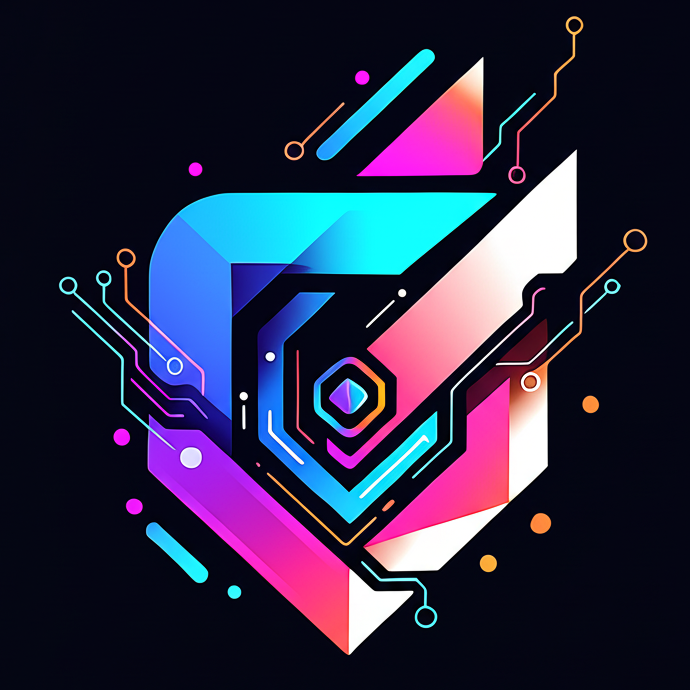
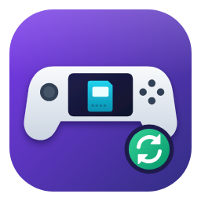

# Disclosure

This project was primarily created for personal use and for my family. While I may provide updates, they are not guaranteed. However, if you've stumbled upon this and find it interesting, feel free to download and use it. I had a great time building this and hope you enjoy it.

Note: Built with the assistance of Claude.ai. I’m putting it here now so you don't have to hunt for it below.

  

# RomM Deck

A [Decky Loader](https://github.com/SteamDeckHomebrew/decky-loader) plugin that brings your self-hosted
[RomM](https://github.com/rommapp/romm) library into Game Mode on a Bazzite or SteamOS handheld running
[EmuDeck](https://www.emudeck.com/). Everything is done from the Quick Access menu: no terminal and no
commands.

**Beta (0.5.3).** Built and tested on a ROG Xbox Ally X with Bazzite, EmuDeck and RomM 5.4.1.

- **Download games** from RomM into the right `Emulation/roms` folder, with a Steam card, cover art and
  the same Steam collection Steam ROM Manager uses. Games already on the PC are recognised.
- **Sync saves and save states** with RomM: pulled before you play, pushed after, however the game is
  closed. No version of a save is ever thrown away.
- **Keep your EmuDeck cards.** Existing cards can sync saves too, keeping their names, artwork and playtime.
- **Remove safely.** A game is only deleted once RomM holds an identical copy of every save.
- **RomM on Steam's game pages**: the description, developer, rating and every other detail, screenshots,
  an Activity list (notes, RetroAchievements unlocks, saves) and links back to RomM.
- **Controller presets**: motion and tilt from the ROG Ally's own sensor for Switch, Wii U and 3DS, and
  real Wii Remotes for Wii. Your emulator settings are as they were after the game.

## Install

**Needs:** Decky Loader with Developer mode on, EmuDeck, and a RomM server (developed against 5.4.1).

1. **Install.** Decky settings → Developer → **Install plugin from URL**, and enter
   `https://github.com/soullink9/Decky-RomM_Deck/releases/latest/download/romm-deck.zip`
   ([other ways](docs/Installation.md#installing-the-plugin)).
2. **Get a pairing code.** In RomM's web UI: Settings → **Client API Tokens** → create a token with the
   permissions in [Installation](docs/Installation.md#the-romm-token), then choose **Pair device**.
3. **Pair.** Open RomM Deck in the Quick Access menu and enter your RomM address and the code.

## Documentation

| Page | What's in it |
|---|---|
| [Installation](docs/Installation.md) | Installing, pairing, the token's permissions, updating and removing |
| [Library and Downloads](docs/Library-and-Downloads.md) | Browsing, downloading, Steam cards, games already on the PC, Switch updates and DLC, BIOS |
| [Saves and States](docs/Saves-and-States.md) | How sync works, the save buttons, conflicts and backups, closing games, removing safely |
| [Steam Game Pages](docs/Steam-Game-Pages.md) | RomM's details, screenshots, Activity and links on Steam's pages |
| [Controller Presets](docs/Controller-Presets.md) | Ally motion and calibration, real Wii Remotes, how settings are put back |
| [Platforms and Emulators](docs/Platforms-and-Emulators.md) | Every supported platform, its folder and emulator, and where saves are looked for |
| [Troubleshooting](docs/Troubleshooting.md) | Logs, common questions and known issues |
| [Privacy and Security](docs/Privacy-and-Security.md) | What's sent where, the token, and every file the plugin keeps |
| [Changelog](CHANGELOG.md) | What's in each release |

## Repository layout

| Folder | What's in it |
|---|---|
| [`src/`](src) | The frontend: the Quick Access panel, Steam cards and game pages (TypeScript). |
| [`main.py`](main.py), [`py_modules/romm_deck/`](py_modules/romm_deck) | The backend Decky runs (Python). |
| [`bin/`](bin) | The game launcher every card runs, and the motion server. |
| [`docs/`](docs) | The documentation pages above. |
| [`tests/`](tests) | The tests, with a fake RomM server. |
| [`scripts/`](scripts), [`.gitea/`](.gitea), [`.github/`](.github) | Building, checking and publishing releases. |
| [`assets/brand/`](assets/brand) | The plugin's icon. |

New to the code? [ARCHITECTURE.md](ARCHITECTURE.md) explains how the plugin is built and how data flows
through it.

Bug reports and pull requests are welcome: [open an issue](https://github.com/soullink9/Decky-RomM_Deck/issues/new/choose)
and fill in the form. [CONTRIBUTING.md](CONTRIBUTING.md) explains how the repository works, and the
[Code of Conduct](CODE_OF_CONDUCT.md) applies everywhere here.

## Credits

Work from other people this project uses or learned from:

- **[Decky Loader](https://github.com/SteamDeckHomebrew/decky-loader)** (Steam Deck Homebrew) runs the
  plugin and provides its frontend API.
- **[MetaDeck](https://github.com/EmuDeck/MetaDeck)** and **[Decky Metadata](https://github.com/beallio/Decky-Metadata)**
  showed how to put metadata on Steam's game pages for non-Steam games, and the safeguards that keep Steam
  stable. RomM Deck's Steam page code follows the same approach.
- **[SteamDeckGyroDSU](https://github.com/kmicki/SteamDeckGyroDSU)** (kmicki, MIT) is the reference for the
  motion axes sent to emulators. **[SDL](https://github.com/libsdl-org/SDL)** and
  **[InputPlumber](https://github.com/ShadowBlip/InputPlumber)** document the Steam Deck controller's
  motion report the plugin reads.
- **[EmuDeck](https://github.com/dragoonDorise/EmuDeck)**: the plugin uses EmuDeck's folders, launcher
  scripts, Steam ROM Manager collection names and emulator settings. The test fixtures are short excerpts
  of EmuDeck's default emulator configuration.
- **[Dolphin](https://github.com/dolphin-emu/dolphin)**: its source documents the command-line settings and
  Wii Remote messages the real Wii Remote preset uses.
- **[Decky Plugin Store](https://github.com/SteamDeckHomebrew/decky-plugin-store)** (Steam Deck Homebrew): the
  store format the release scripts write for a self-hosted Decky store.
- **[Material Design Icons](https://github.com/google/material-design-icons)** (Google, Apache 2.0): the
  icons in the panel.

Data the plugin shows comes from your RomM server, which gathers it from sources such as IGDB,
RetroAchievements and HowLongToBeat. Achievement badges load from RetroAchievements' own image server.

This project is not affiliated with or endorsed by RomM, Valve, the Decky Loader or EmuDeck projects,
ASUS, Microsoft, Nintendo, Sony or Sega. Steam and Steam Deck are trademarks of Valve Corporation; other
names belong to their owners.

Everything else was written for this project, with help from Claude, Anthropic's AI model.

## License

[BSD 3-Clause License](LICENSE).
